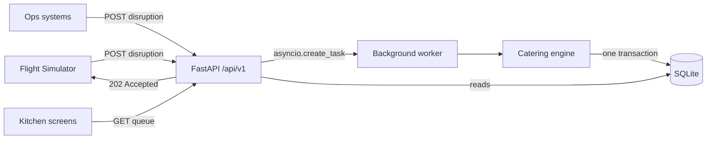

# SkyFlow API — Home (MOC)

Event-driven catering broker for 24/7 flight operations (300+ flights/day). Disruptions are acknowledged instantly with `202`, then processed in the background.

## Architecture at a glance

## Map of notes
- [[Interview Walkthrough]] — high-level and detailed walkthrough for explaining the project
- [[Architecture]] — layers, module map, key design decisions
- [[Data Model]] — tables, constraints, relationships
- [[API Reference]] — endpoints and payloads
- [[Catering Engine]] — meal demand rules and transaction flow
- [[Simulator and Seeding]] — mock data and live traffic
- [[Deployment and Testing]] — Docker, local run, test coverage

> [!tip] Start here
> Run `docker compose up --build`, open `/docs`, then POST a delay for `QR1050` and watch `/api/v1/kitchen/queue` change.
