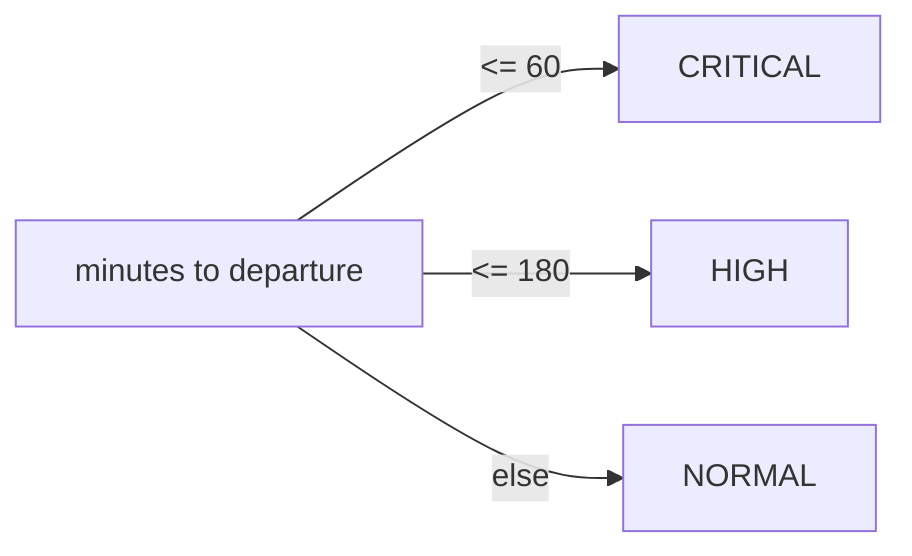

# API Reference

Back to [[00_Home]] · Logic behind it: [[Catering Engine]] · Tables: [[Data Model]]

| Endpoint | Notes |
|----------|-------|
| `GET /api/v1/flights/` | Pagination (`limit` 1–200, `offset`) and `status` filter |
| `GET /api/v1/flights/{id}` | Flight + manifest + meal inventory; `404` if unknown |
| `PATCH /api/v1/flights/{id}/status` | Synchronous; recalculates meals in the same transaction |
| `POST /api/v1/events/disruption` | `202` immediately; `404` unknown flight; `422` bad payload |
| `GET /api/v1/kitchen/queue` | Closest departure first; excludes cancelled, departed and fully-assembled flights |
| `GET /api/v1/kitchen/logs` | Audit trail, newest first |
| `GET /health` | Liveness |

## Event types
- `FLIGHT_DELAY` — requires `delay_minutes`
- `PASSENGER_COUNT_CHANGE` — requires a non-zero `passenger_delta` (signed, clamped at 0)
- `FLIGHT_CANCELLATION`
- `STATUS_CHANGE` — requires `new_status`

## Queue priority

> [!tip]
> Interactive docs live at `/docs` (Swagger) and `/redoc`.
