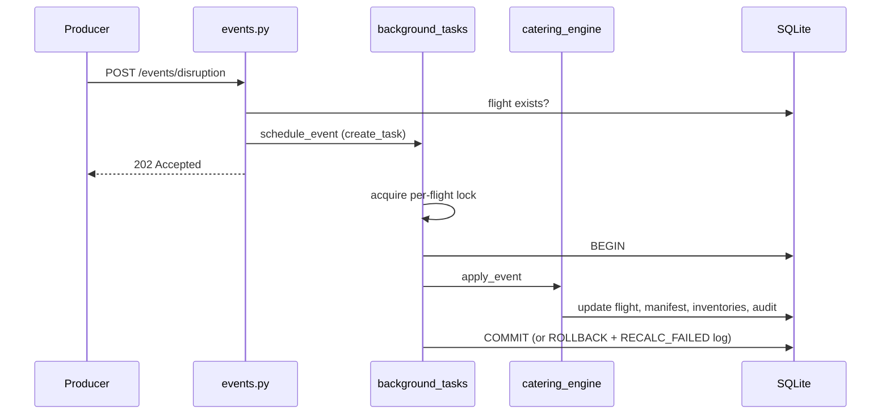

# Architecture

Back to [[00_Home]] · See [[Data Model]], [[API Reference]], [[Catering Engine]]

## Layers

| Layer | Path | Responsibility |
|-------|------|----------------|
| API | `app/api/v1/` | HTTP, validation, status codes — no business logic |
| Schemas | `app/schemas/` | Pydantic v2 request/response contracts |
| Services | `app/services/` | [[Catering Engine]] (pure + stateful logic), background dispatcher |
| Persistence | `app/models/`, `app/database.py` | SQLAlchemy 2.0 async ORM over SQLite |
| Simulator | `app/simulator/` | See [[Simulator and Seeding]] |

## Request lifecycle (disruption)

## Key decisions
- **Atomic updates** — the engine never commits; the caller owns the transaction.
- **Per-flight `asyncio.Lock`** — serialises read-modify-write for one flight.
- **Narrow dispatcher** — `schedule_event` / `execute_event` can be swapped for Celery/Redis.

> [!warning] Single process
> Tasks and locks are in-process. Run one uvicorn worker; unfinished tasks are lost on a hard kill.
