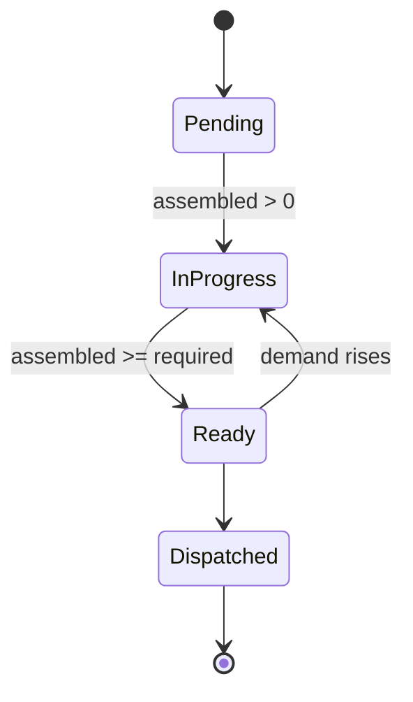
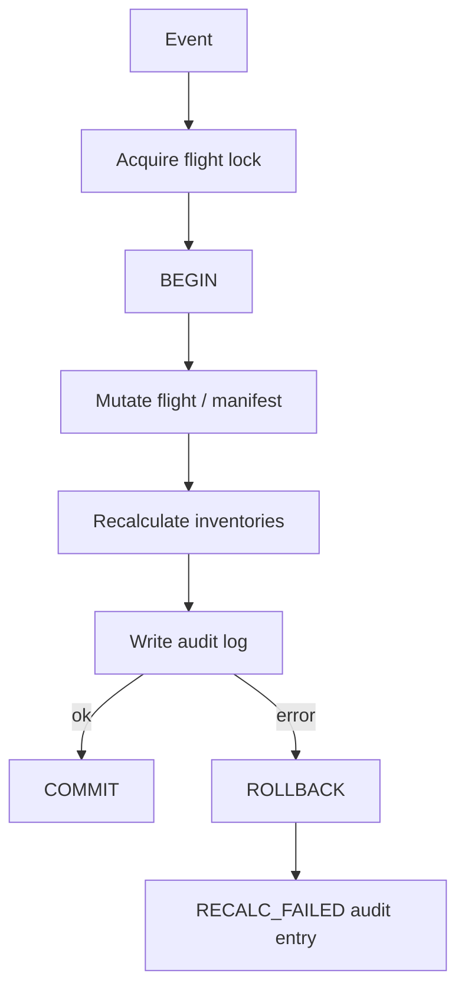

# Catering Engine

Back to [[00_Home]] · Context: [[Architecture]] · Storage: [[Data Model]] · Triggered by [[API Reference]]

## Demand rules
1. Meals = passengers (all classes) + crew.
2. Cumulative delay >= 60 min → +5 % buffer, rounded up (`LONG_DELAY_THRESHOLD_MINUTES`, `SAFETY_BUFFER_PCT`).
3. Cancelled → 0 meals; further events are ignored and audited (`EVENT_IGNORED`).
4. Split: Standard 50 %, Halal 25 %, Vegetarian 12 %, Vegan 5 %, Special Dietary 8 % — largest-remainder so the parts sum exactly.
5. Assembled meals are never erased.

## Meal status

## Transaction flow

> [!warning] Rollback guarantee
> Tests verify that a failure after mutation leaves the flight, manifest and inventories untouched.
