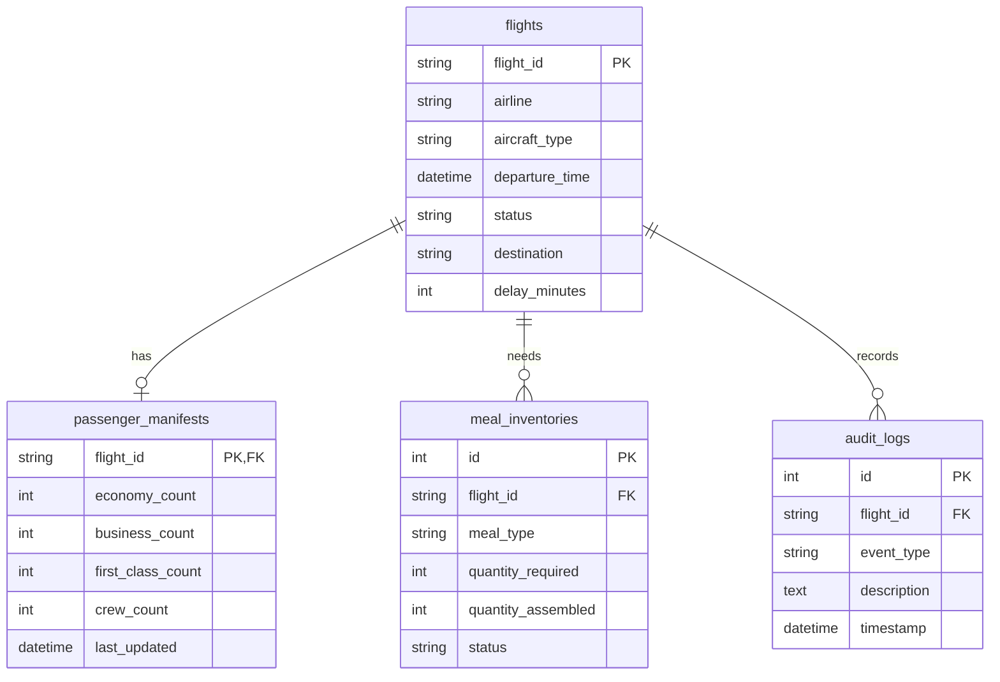

# Data Model

Back to [[00_Home]] · Used by [[Catering Engine]] · Exposed via [[API Reference]]

- Enums (status, aircraft, meal type/status) are stored as text with `CHECK` constraints.
- `UNIQUE(flight_id, meal_type)` on inventories; counts are `CHECK >= 0`.
- Foreign keys are enforced (`PRAGMA foreign_keys=ON`) and cascade on delete.

> [!info] Schema addition
> `flights.delay_minutes` is not in the original spec. It stores cumulative delay so the safety buffer works across multiple events.
