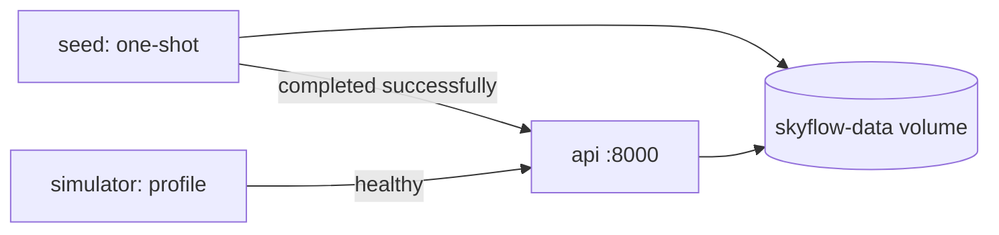

# Deployment and Testing

Back to [[00_Home]] · See [[Architecture]] · [[Simulator and Seeding]]

## Docker Compose

- `docker compose up --build` → seed, then API on `:8000/docs`.
- `docker compose --profile simulator up` adds live traffic.
- Image runs as a non-root user with a `/health` healthcheck.

> [!tip] Local configuration
> Copy `.env.example` to `.env`. `app/config.py` loads it with `python-dotenv`. Docker sets `DATABASE_URL` in the image and does not need that file. See [[00_Home]].

> [!info] Container run
> `docker compose up --build` has been run on this machine: the image builds, seed loads 300 flights, and `/health` returns 200.

## Tests (`pytest`)
- `tests/test_catering_engine.py` — pure rules, event application, rollback, concurrency.
- `tests/test_api.py` — status codes, validation, `202`-before-processing, queue order, logs, FK enforcement.
- Each test uses an isolated SQLite file.
