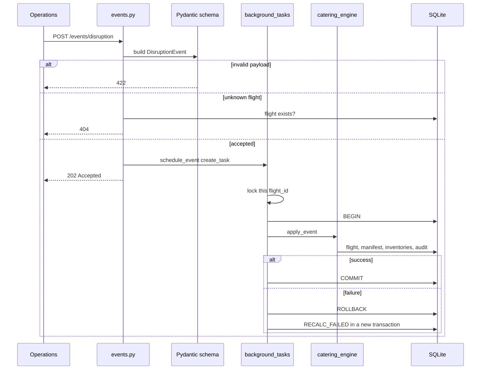
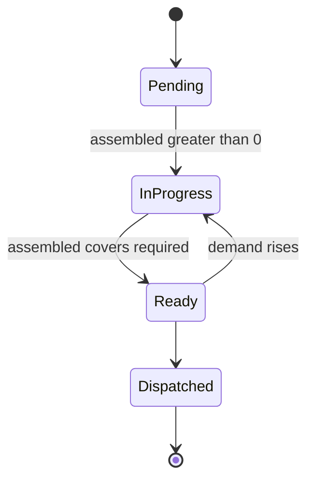
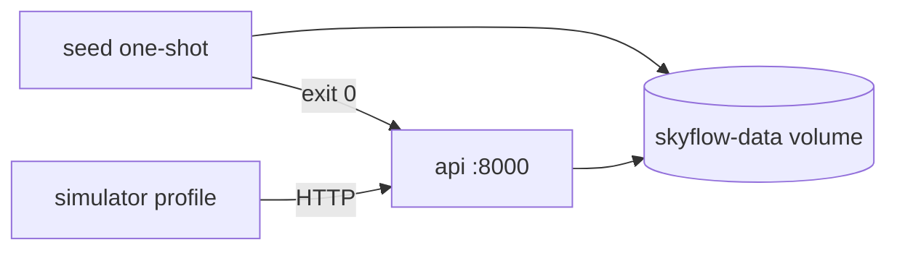

# Interview Walkthrough

Back to [[00_Home]]. Related: [[Architecture]], [[Data Model]], [[API Reference]], [[Catering Engine]], [[Simulator and Seeding]], [[Deployment and Testing]].

SkyFlow is an operational broker. A delay or passenger change comes in, the API says "accepted" immediately, and a background task recalculates meals, writes the database in one transaction, and the kitchen queue reads the new state.

> [!tip] The sentence to open with
> Qatar Airways-style catering for 300 flights a day. The API does not cook meals. It keeps the numbers the kitchen works from.

## 60-second version

Four tables: flights, passenger manifests, meal inventories, audit logs. When operations posts a disruption, FastAPI validates it with Pydantic and returns **202 Accepted** before the math finishes. An asyncio task then updates the flight, the manifest, every meal row, and an audit line in **one transaction**. If anything fails, the whole change rolls back and a `RECALC_FAILED` log is written instead.

The kitchen calls `GET /api/v1/kitchen/queue` and gets flights ordered by closest departure, skipping cancelled, already-departed, and fully assembled ones.

## Folder map

HTTP, validation, business logic, and persistence are separate packages so a route never contains meal math.

| Path | Job | Line to say |
|---|---|---|
| `app/main.py` | Creates the FastAPI app, mounts routers, startup/shutdown | The process starts here. Routes do not. |
| `app/config.py` | Settings from environment, with defaults | Thresholds are config, not magic numbers in the engine. |
| `app/database.py` | Async SQLite engine, sessions, table creation | One place owns connections and SQLite pragmas. |
| `app/models/` | SQLAlchemy tables | What is stored. See [[Data Model]]. |
| `app/schemas/` | Pydantic request and response shapes | What crosses the wire. Different from the tables on purpose. |
| `app/api/v1/` | Routes only | Status codes, query params, call a service. See [[API Reference]]. |
| `app/services/` | Meal math and background tasks | The product lives here. See [[Catering Engine]]. |
| `app/simulator/` | Fake live traffic | A client of the API, not part of the engine. See [[Simulator and Seeding]]. |
| `scripts/seed_db.py` | 300 flights on first boot | Runs once, then exits. |
| `tests/` | Engine rules and HTTP behavior | Pure math tested without HTTP; HTTP tested without a real server process. |
| `Dockerfile`, `docker-compose.yml` | How it runs | Seed finishes successfully, then the API starts on the same database volume. See [[Deployment and Testing]]. |

> [!info] Models versus schemas
> A model is a row. A schema is a JSON contract. The kitchen response adds `priority`, `rank`, and `minutes_to_departure`. Those are computed for the caller. They are not columns.

## Follow one delay

1. `POST /api/v1/events/disruption` hits `app/api/v1/events.py`. FastAPI builds a `DisruptionEvent` before the function runs. A delay with no `delay_minutes` never enters the function. Pydantic returns **422**.
2. The route checks the flight exists. An unknown id is **404** now, not after the client has already been told 202.
3. `schedule_event` calls `asyncio.create_task` and the route returns 202. The HTTP worker is free for the next flight.
4. The task takes a lock for that flight id, opens its **own** database session, and starts a transaction. The request's session is already finished. Background work must not reuse it.
5. `catering_engine.apply_event` changes the flight (departure moves, `delay_minutes` adds up, status becomes Delayed), recomputes meal quantities, and adds an audit row. It does **not** commit. The caller commits.
6. `session.begin()` commits if `apply_event` returns, and rolls back if it raises. A failure then writes `RECALC_FAILED` in a second, separate transaction, because the first transaction is already gone.

> [!tip] Why 202 and not 200
> 200 means the work is done. 202 means accepted for processing. The kitchen must read the flight again to see the new meals. In the container log, the response comes back, then `skyflow.worker` logs the recalculation.

## Why the engine is split in two

`compute_meal_requirements` and `derive_meal_status` take numbers and return numbers. No database. Tests call them directly. `apply_event` is the stateful half: it loads the flight with its manifest and inventories, mutates them, and flushes so a constraint error happens inside the transaction. Details in [[Catering Engine]].

Rules worth stating:

- Meals equal economy + business + first + crew.
- Split is 50% Standard, 25% Halal, 12% Vegetarian, 5% Vegan, 8% Special Dietary, using largest-remainder rounding so the parts sum to the total. Floor each share, then give the leftover meals to the biggest fractional remainders.
- Cumulative delay of 60 minutes or more adds 5%. Both numbers come from `config.py` (`LONG_DELAY_THRESHOLD_MINUTES`, `SAFETY_BUFFER_PCT`).
- `delay_minutes` is stored on the flight because one 30-minute delay plus a later 45-minute delay is 75, and only the total crosses the buffer.
- Cancelled flights need zero meals. Later delays on a cancelled flight are ignored and logged as `EVENT_IGNORED`, so a stray event cannot recreate an order.
- `quantity_assembled` is never reduced. If demand rises after the kitchen has cooked, status goes back from Ready to In-Progress. Dispatched stays Dispatched.

## Concurrency

Two events for the same flight can arrive together. Both would read "100 economy," both would add 10, and the second write would erase the first. The per-flight `asyncio.Lock` in `background_tasks.py` makes those two run one after the other. Different flights do not wait on each other.

The set `_pending` exists because asyncio only keeps a weak reference to a task. If nothing else holds it, the task can be garbage-collected mid-flight. On shutdown, `lifespan` in `main.py` waits for those tasks, then closes the engine.

## Database choices

`app/database.py` turns on three SQLite pragmas for every connection. See [[Data Model]].

- `foreign_keys=ON` — SQLite does not enforce foreign keys unless asked. A meal row for a missing flight must fail.
- `journal_mode=WAL` — readers and the background writer block each other less.
- `busy_timeout=30000` — a writer waits instead of failing instantly when the file is busy.

Enums such as `Scheduled` and `Halal` are stored as text with a CHECK constraint. Timestamps are naive UTC because SQLite has no timezone type. `utcnow()` in `database.py` is the single clock.

Relationships use `ondelete="CASCADE"`. Deleting a flight deletes its manifest, meals, and logs. Inventories also have `UNIQUE(flight_id, meal_type)` so a flight cannot have two Halal rows.

## API surface

| Route | Sync or async | Why |
|---|---|---|
| `GET /api/v1/flights/` | Sync read | Pagination and status filter. Reads are cheap. |
| `GET /api/v1/flights/{id}` | Sync read | Flight plus manifest plus meals. |
| `PATCH /api/v1/flights/{id}/status` | Sync write | A cancellation should be finished before the response. It awaits `execute_event`. |
| `POST /api/v1/events/disruption` | 202 plus background | Producers must not wait on kitchen math. |
| `GET /api/v1/kitchen/queue` | Sync read | Sort by departure. Drop flights with nothing left to cook. |
| `GET /api/v1/kitchen/logs` | Sync read | Audit trail, newest first. |
| `GET /health` | Sync | Docker healthcheck. |

Queue priority: CRITICAL within 60 minutes, HIGH within 3 hours, otherwise NORMAL.

`Depends(get_session)` is how tests swap in a throwaway database without changing route code. Each test gets its own SQLite file and overrides `get_session` and `get_session_factory`.

## Docker story

- `seed` runs `scripts/seed_db.py` and exits. A second start sees 300 flights and does nothing.
- `api` starts only after seed exits 0. Both mount `skyflow-data` at `/data`, so they share `skyflow.db`.
- `simulator` is behind a Compose profile. A normal `docker compose up` does not start it. It posts a random delay or passenger surge every 15–30 seconds. It is an HTTP client, which proves the public contract works.

The image runs as user `skyflow`, not root. Uvicorn is one worker.

> [!warning] Say this before they ask
> Tasks and locks live in the process. Two workers would each have their own lock and could race. A real queue such as Celery or Redis would replace `schedule_event` only. Routes and `apply_event` stay. A hard kill can drop a task that has not committed. Graceful shutdown waits up to `SHUTDOWN_GRACE_SECONDS`.

## What to admit

- SQLite fits this demo. Many app servers writing one file does not. The session and engine are already behind a factory, so Postgres is a URL change plus a migration tool. `create_all` on startup is fine here. Production would use Alembic.
- 202 has no job-status URL. The client polls the flight or the audit log. A durable queue would add retries and a status endpoint.
- The event id in the 202 body is a UUID for the caller. It is not stored, so that id cannot be looked up later.
- The meal mix is a fixed percentage, not real special-meal orders from a passenger record.

## If they go deep

**Why not do the math inside the route?** The route would be hard to test, and a slow recalc would hold the HTTP connection. One test blocks the engine and still gets 202 within two seconds.

**How do you know a failure does not half-update?** `session.begin()` wraps flight, manifest, inventories, and the audit row. A test mutates inventories and then raises. Counts stay at the old values and no success audit exists. A `RECALC_FAILED` row is written afterward.

**Why largest remainder?** Independent rounding of 50%, 25%, 12%, 5%, and 8% can sum to 99 or 101. The algorithm floors, then assigns the leftover meals by fractional remainder, so 100 passengers always produce 100 meals.

**What is the simulator for?** It is a load-shaped client. It never imports the engine. If the JSON contract breaks, the simulator fails the same way operations would.
