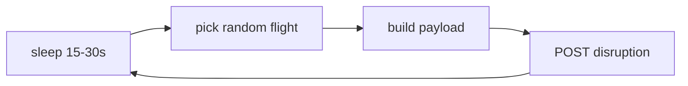

# Simulator and Seeding

Back to [[00_Home]] · Posts to [[API Reference]] · Data shape in [[Data Model]]

## Seeding — `scripts/seed_db.py`
- Builds 300 flights with `pandas` + `faker`, departures spread over the next 24 h.
- Aircraft mix (A320 / A350 / B777) with realistic cabin counts; ~13 % delayed, ~3 % cancelled, a few boarding.
- Meal inventories use the [[Catering Engine]] rules; assembly progress rises as departure nears.
- Idempotent: skips if data exists; `--force` wipes and re-seeds in one transaction.

## Live simulator — `app/simulator/flight_simulator.py`
Every 15–30 s: pick a random Scheduled/Delayed flight → 60 % delay, 40 % passenger surge → `POST /api/v1/events/disruption`.

> [!tip] Faster demo
> `python -m app.simulator.flight_simulator --min-interval 1 --max-interval 3`
